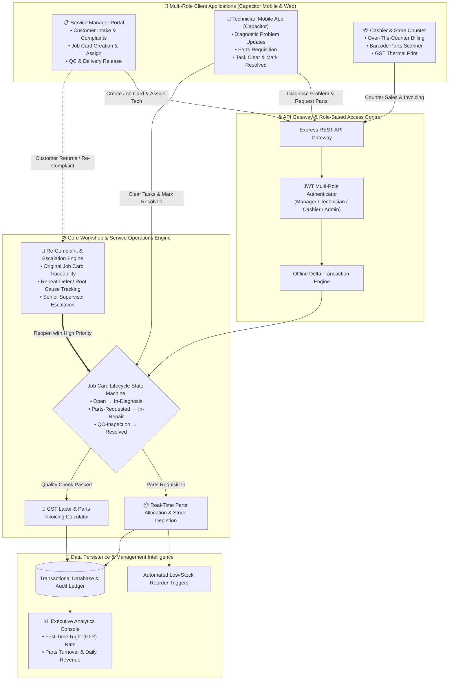

# 🏍️ Bajaj Dealership & Service Operations Enterprise SaaS

### **End-to-End Dealership ERP: Service Job Card Lifecycle, Technician Telemetry, Spare Parts Inventory & POS Billing**

 

Designed & Engineered by **[Obaidhur Rahaman](https://rahaman1721.framer.website)** · Full Stack Developer & UI/UX Designer  
*Digitizing high-throughput authorized automotive dealerships, workshop service bays, parts ledgers, and customer ticket lifecycles.*

---

> [!NOTE]  
> **Enterprise NDA Notice:** This repository contains architectural documentation, system designs, and operational case study analysis. In compliance with client non-disclosure agreements, proprietary source code, database credentials, internal customer logs, and vehicle registration numbers have been strictly omitted.

---

## 📌 Executive Summary & Problem Context

Authorized automotive dealerships and multi-bay service workshops operate under extreme operational velocity. In traditional facilities across South India, operations suffered from critical operational fragmentation:

1. **Job Card Paper Loss & Bottlenecks:** Physical job sheets moving between Service Advisors and mechanics frequently went missing or suffered illegible handwriting, causing diagnosis mix-ups.
2. **Untracked Spare Parts Shrinkage:** High-value genuine spare parts (spark plugs, gaskets, brake pads, engine oils) were issued without automated ledger debits, causing end-of-month inventory deficits.
3. **Technician Idle Time & Lack of Telemetry:** Service Managers had zero live visibility into mechanic bay allocations, ongoing diagnosis stages, or reasons for repair delays.
4. **Unmanaged Re-Complaints:** When a customer returned with a recurring complaint, service staff lacked quick access to historical Job Card notes and parts replaced, leading to customer churn and warranty disputes.

This platform digitizes the entire dealership ecosystem into a **unified, multi-role mobile and web architecture** connecting Service Advisors, Workshop Mechanics, Parts Inventory Managers, and Cashiers.

---

## 🏗️ High-Tech System Architecture & Workshop Data Flow

The platform is architected around an **event-driven Job Card state machine**, synchronizing field mechanics on mobile devices with the central parts store and invoicing terminals.

---

## 🔬 Multi-Role Operational Workflows

### 1. Service Advisor & Customer Intake Portal
- Customer and vehicle intake via registration number lookup with historical repair records.
- Primary complaint logging (e.g., engine knocking, brake slippage, cold start failure, scheduled periodic service).
- Automated Job Card generation with estimated delivery time and supervisor assignment to dedicated service bay technicians.

### 2. Technician Mobile App (Mechanic Workspace)
- **Assigned Queue**: Technicians receive mobile push notifications of newly assigned vehicles.
- **Diagnostic Telemetry**: Mechanic updates problem details, logs findings, and requests specific OEM parts (SKU/barcode matched) directly from the parts warehouse.
- **Progress Tracking**: Real-time status toggling (`In Progress` $\rightarrow$ `Awaiting Parts` $\rightarrow$ `Work Complete`).
- **Clear All & Mark Resolved**: Once mechanical and electrical repairs are completed, the technician signs off, automatically flagging the unit for Quality Control (QC) inspection.

### 3. Re-Complaint & Repeat-Defect Escalation Engine
- If a customer returns within 30 days reporting an unresolved problem, the system enforces a strict **Re-Complaint Protocol**.
- Links directly to the original Job Card, flagging the technician and parts previously utilized.
- Escalates directly to the Chief Workshop Foreman for mandatory secondary inspection, preventing repeat-defect oversights and tracking First-Time-Right (FTR) technician performance.

### 4. Spare Parts Inventory & Stock Depletion Ledger
- Centralized OEM parts catalog with barcode scanner integration.
- Two-way depletion triggers:
  1. **Workshop Consumption**: Parts issued directly to active Job Cards are debited from available inventory immediately.
  2. **Over-The-Counter Retail Sales**: Counter walk-ins purchase spare parts with instant receipt generation.
- Automated low-stock thresholds notify store managers before critical consumables (filters, oils, brake shoes) run out.

### 5. Point-of-Sale (POS) & GST Invoicing
- Automated invoice compilation combining:
  - Consumed spare parts (itemized with HSN codes and GST slab calculation).
  - Workshop labor charges (standard time rate matrix).
- One-click print bridge to Bluetooth 58mm/80mm thermal receipt printers.
- Split-payment reconciliation (UPI, Cash, Debit Card, Credit Ledger).

---

## 🛠️ Technology Stack & Engineering Architecture

| Layer | Technologies | Architectural Function |
|:---|:---|:---|
| **Mobile Runtime** | Capacitor (Android), HTML5, CSS3 | Low-latency mobile client for bay mechanics and floor supervisors. |
| **Frontend Framework** | React 19, TypeScript, Vite | High-density desktop portal for Service Managers, Parts Clerks, and Cashiers. |
| **Backend Engine** | Node.js, Express.js | Micro-service REST API handling multi-tenant concurrency and transactional locks. |
| **Data & Cache Layer** | IndexedDB (Client) + Encrypted SQL Ledger | Offline-first transactional synchronization during workshop Wi-Fi blindspots. |
| **Hardware Integrations** | Camera Barcode / QR Scanner, Bluetooth Thermal Printer | Instant part identification and customer invoice printing. |

---

## 📈 Verified Business Impact & Metrics

- **~50% Reduction in Administrative Overhead:** Replaced manual handwritten paper job cards with instantaneous digital updates.
- **99.4% Parts Reconciliation Accuracy:** Automated stock debits upon technician job-card allocation eliminated untracked spare parts shrinkage.
- **35% Drop in Customer Delivery Wait Times:** Real-time bay status tracking enabled proactive customer notifications as soon as vehicles passed QC inspection.
- **First-Time-Right (FTR) Quality Improvement:** Re-complaint loop pinpointed recurring failure modes, significantly elevating workshop customer satisfaction scores.

---
---

## 👨‍💻 Author

**Obaidhur Rahaman**  
Full Stack Developer & Lead UI/UX Designer  

- 🌐 **Portfolio**: [https://rahaman1721.framer.website](https://rahaman1721.framer.website)  
- 🐙 **GitHub**: [@rahaman1721](https://github.com/rahaman1721)  
- 💼 **LinkedIn**: [linkedin.com/in/obaidhur-rahaman-1721z](https://www.linkedin.com/in/obaidhur-rahaman-1721z)  
- 📧 **Email**: [rahaman171920@gmail.com](mailto:rahaman171920@gmail.com)  

  Designed & Developed with precision by Obaidhur Rahaman © 2026

