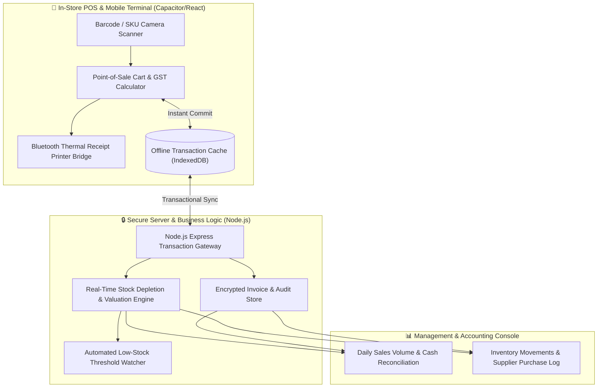

# Bajaj Billing & Inventory Management App

> **NDA Project** — This repository contains case study documentation only. No source code, APK, database schemas, customer records, or client data is published.

## Overview

An end-to-end billing and inventory management SaaS application developed independently for a retail business client in Madurai, Tamil Nadu. The application digitized paper-based billing workflows and enabled real-time stock visibility across the business.

## Problem Statement

The client relied on manual, paper-based billing and inventory tracking. This created errors in stock counts, delayed invoice generation, and significant time spent on reconciliation at end of day.

## Solution

A hybrid mobile and web application that automates the full billing cycle — from product scanning to invoice generation — and provides real-time inventory tracking with low-stock alerts.

## Key Features

- Automated invoice generation & GST-compliant receipt printing
- Real-time stock tracking and multi-category inventory ledger
- Barcode/SKU quick lookup and itemized cart management
- Automatic low-stock threshold alerts and reorder notifications
- End-of-day sales reconciliation and accounting summaries
- Cross-platform Android deployment via Capacitor with offline transactional caching

---

## 🏗️ System Architecture & Transactional Data Flow

The platform utilizes a **resilient point-of-sale architecture**, decoupling fast in-store cashier interactions from inventory ledger synchronization to ensure transactions are never blocked by network latency.

### 🔬 Engineering & Operational Highlights

1. **Sub-Second Cashier Checkout**:
   - In peak retail hours, cashier throughput is vital. Cart operations, tax computations, and receipt printing occur locally without waiting for cloud round-trips.
2. **Atomic Inventory Reconciliation**:
   - Every finalized sale dispatches atomic stock adjustments, instantly updating active units and triggering immediate push alerts when stock falls below reorder thresholds.
3. **Verified Enterprise Impact**:
   - Replacing manual paper ledgers with automated scanning and receipt compilation achieved a verified **~50% reduction in manual data entry** and eliminated end-of-day cash reconciliation discrepancies.

## My Role

Independently designed, developed, and deployed the complete application:
- Requirement gathering and business analysis
- UI/UX interface design
- Frontend development (React 19, Vite)
- Backend development (Node.js)
- Android packaging and deployment (Capacitor)
- Client training and handover

## Technology Stack

| Layer | Technology |
|---|---|
| Frontend | React 19, Vite |
| Backend | Node.js |
| Mobile | Capacitor (Android) |
| Styling | CSS3, Responsive Design |

## Business Outcome

Approximately **50% reduction in manual data entry** and significant reduction in paper-based billing errors following deployment.

## Status

Deployed and in active use by the client.

---

**Obaidhur Rahaman** | [rahaman1721.framer.website](https://rahaman1721.framer.website) | [LinkedIn](https://www.linkedin.com/in/obaidhur-rahaman-1721z)
